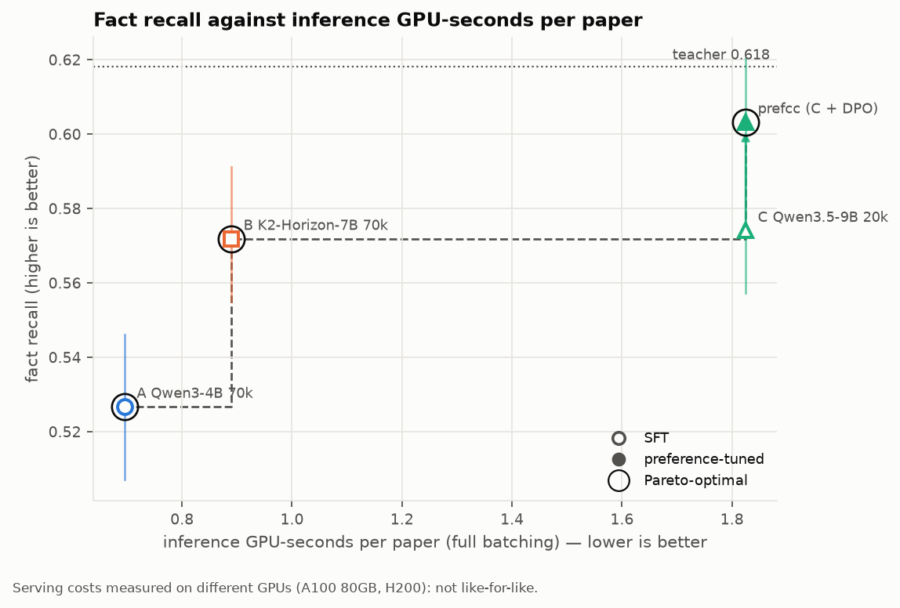

# Analysis: quality, latency and resources, and choosing the production student

This document explains how to measure the five students on the same footing and how to choose one. It covers
what to run, how to measure so the numbers can be compared, what each number means and how noisy it is, how
to read the Pareto plots, and the decision procedure. A report template is in
`docs/DECISION_REPORT_TEMPLATE.md`, and a worked example with real numbers from the previous project is in
`docs/figures/example_old_students/`.

## The tools

All tools are in `scripts/analysis/`.

| script | what it produces | reads | where to run |
|---|---|---|---|
| `bench_inference.py` | latency (TTFT, TPOT, end-to-end p50/p95), offline throughput, GPU-seconds per paper, memory, model load time, hardware/software fingerprint → `runs/<run>/bench/<ckpt>.json` | the student profile, its adapter, the built test prompts | one GPU, alone on it |
| `merge_adapter.py` | the adapter merged into the base model, to benchmark a merged deployment (untested on the new students) | profile + adapter | GPU node, or CPU node with RAM ≥ 2 bytes × parameters |
| `train_resources.py` | wall time, GPU-hours, tokens/s per GPU, peak memory, cost per 1,000 papers, held-out loss curve | `runs/<run>/metrics.jsonl`, `run.json` | anywhere (CPU) |
| `collect_results.py` | one table for all systems: quality with intervals, the four criteria against each student's own SFT model, training and serving cost → `results.{json,csv,md}` | eval scores, judge, fact grades, claim checks, training metrics, benchmarks | CPU node (the bootstrap takes about a minute) |
| `pareto.py` | Pareto plots (PNG + SVG) and a decision table → `decision.{md,json}` | `results.json` | CPU node |
| `learning_curves.py` | learning curves, one figure per measure with all students overlaid, and one page per run | `runs/<run>/metrics.jsonl`, milestone evaluations | CPU node |

The usual end-of-project sequence:

```bash
python scripts/analysis/collect_results.py --out-dir reports/analysis            # all configs/students/*.env
python scripts/analysis/pareto.py reports/analysis/results.json --out-dir reports/analysis/pareto \
    --require-criteria --recall-floor -0.02 --load 100000
RUNS=$(ls runs | grep -E -- '-(sft50k|prefcc|prefcc-s2)$')
python scripts/analysis/learning_curves.py $RUNS --out-dir reports/curves
python scripts/analysis/train_resources.py $RUNS --out-md reports/analysis/train_resources.md \
    --out-json reports/analysis/train_resources.json
```

`collect_results.py` finds the systems in `configs/students/*.env`. Each student gives two systems:
- `<tag> SFT`: run `<tag>-sft50k`.
- `<tag> prefcc`: the per-paper mean of `<tag>-prefcc` and `<tag>-prefcc-s2`, with `<tag> SFT` as its
  reference.

Use `--systems file.json` for any other set: the anchors (C and prefcc re-graded with your graders), a single
seed, and so on. The format is in the script's docstring.

## Measurement protocol

### Quality (on the test papers)

| measure | definition | papers | noise to expect (from the previous project) |
|---|---|---|---|
| **fact recall** (primary) | questions written from the full paper by one model, answered from the summary alone and graded by another; correct + ½ partial | two question sets, ~900 papers | paired 95% interval of about ±0.006 on a difference between two systems; the order of the DPO pairs alone moved recall by 0.010–0.020 |
| strict recall | correct answers only (partial credit can be earned by guessing) | same | similar |
| **unsupported share** | the share of a summary's statements that the claim check finds unsupported or contradicted by the whole paper | ~300 | about ±0.005 on a paired difference |
| length ratio | summary length / teacher length (criterion 2: 0.90–1.10) | all | small |
| ROUGE-L, BERTScore | overlap with the teacher's summary (criterion 3: no more than 0.010 below the SFT model) | all | about ±0.002 |
| NLI faithfulness | sentence-level entailment against retrieved paper passages (reported, not a criterion) | 300 | about ±0.010 |
| judge faithfulness | a 1–5 score from an LLM judge that reads a 9,000-character excerpt (reported) | 500 | about ±0.05 |
| JSON valid | share of outputs that parse as the eight-field schema | all | |

Rules that keep these numbers comparable:

1. **Same papers, same graders and same prompts for every system.**
   - The graders are self-hosted (`docs/GRADERS.md`). They can differ from the previous project's graders
     in weights revision or precision.
   - So before comparing the new students with the old numbers, re-grade the anchors with your graders:
     the teacher, C and prefcc summaries in `data/anchors/`.
   - Compare new students with each other directly.
2. **Preference-tuned systems are judged on the mean of two seeds** (two pair orders). In the previous
   project one seed passed a criterion that the other failed. SFT models get one seed: the differences
   between students are large compared with the seed noise.
3. **The four criteria are fixed before evaluating** and apply against each student's own SFT model:
   - (1) the recall interval is above zero and p is below 0.05 / k, for k preference systems;
   - (2) the length ratio is 0.90–1.10;
   - (3) ROUGE-L and BERTScore are no more than 0.010 below;
   - (4) the unsupported-share interval reaches zero or below.
4. **Absolute values are comparable only on the same papers.** `--common-papers` restricts every measure to
   the papers that all systems share. Use it whenever some system was graded on fewer papers.

### Inference (`bench_inference.py`)

| rule | why |
|---|---|
| **One GPU type for all students.** On LUMI, one MI250X GCD (one "GPU" to PyTorch, 64 GB) with `--tp 1`; every student up to 9 B fits. | Hardware dominates every latency and throughput number. The fingerprint in each JSON lets `collect_results.py` show mixed hardware, and the Pareto plots print a warning. |
| **Alone on the device**: an exclusive node, or at least an exclusive GCD, with no other job on it. | A shared device makes latency meaningless. |
| **Same papers and decoding**: the first 200 papers of the packaged test list for throughput, and the first 20 after 3 warm-up papers for latency; greedy; the evaluation's token cap (3,000) and window (32,768). | Output length drives cost, and greedy decoding keeps it deterministic. A student that writes longer summaries really is costlier. |
| **Prefix caching off** (the script sets it). | Otherwise repeated prompts get cheaper, and TTFT is wrong. |
| **`--repeats 2`** (the median is reported). Re-run if the two wall times differ by more than 5%. | Filesystem and clock noise. |
| **Serve as you will deploy.** The evaluation serves the LoRA adapter (`--adapter`). If production will serve merged weights, merge them (`merge_adapter.py`) and benchmark with `--model-dir`. Report both if unsure. | LoRA adds overhead per token. |
| **Record the software versions** (they are in the JSON), and re-benchmark every student after a vLLM or ROCm upgrade. | Kernels change between versions. |

What the numbers mean:

- **TTFT** (time to first token) is the time to read the prompt (prefill). It grows with prompt length: a
  median paper is about 10,000 prompt tokens, the p90 about 25,000. The script measures it as the time of a
  1-token generation, or with the engine's per-request timings when vLLM provides them (`ttft_source`).
- **TPOT** (time per output token) is decoding, which is limited by memory bandwidth.
- **End-to-end latency**: a summary is about 1,000 tokens, so end-to-end ≈ TTFT + 1,000 × TPOT, and the decode
  part dominates.
- **GPU-seconds per paper** (from the throughput phase) is the **batch cost**. The Pareto plots and the cost at
  production load use it: GPUs needed = papers per day × GPU-seconds per paper / 86,400 / utilisation.
- **Memory**:
  - `weights_gb` is the on-disk size of the bf16 weights.
  - `kv_gb_per_paper_p95` is the KV cache one paper at the p95 context needs. It is computed from the model
    config and counts only full-attention layers, because hybrid models such as Qwen3.5 keep a fixed-size
    state in their linear-attention layers.
  - What a deployment needs is weights + KV cache × concurrent papers.
  - `engine_reserved_gb` only reflects `--gpu-frac`, because vLLM pre-allocates memory.
- **Load time** (`load_s`) covers engine construction: weight loading, memory profiling and graph capture. It
  matters for autoscaling, not for steady-state cost. The engine's import time is recorded separately
  (`import_s`), because it depends on the filesystem, not on the model. On a busy shared filesystem,
  importing torch and vLLM took 14 minutes in one of the previous project's jobs. On LUMI, keep the
  environment inside the container image, where imports are fast.

### Training (`train_resources.py`)

- **GPU-hours** = the sum over jobs of (time from the trainer's first record to its last) × ranks. Queueing and
  model loading before the first record are not counted.
- **On LUMI one rank is one GCD.** Convert to your project's billing unit yourself; check how the LUMI billing
  policy charges GCD-hours.
- **Compare training cost only on the same GPU type.** In the worked example, prefcc's two seeds differ 3.4× in
  tokens/s only because one ran on an H200 and the other on an L40S.
- **The production recipe costs SFT + one preference run.** The second seed is the cost of verifying the result
  and is reported separately (`verification_gpu_hours`).
- **Not counted** are candidate generation on the pool and grading by the self-hosted graders (the GPU time of
  the grader servers); the pipeline's job log records both. Add them when comparing total project cost. They
  are about the same for every student, except candidate generation, which scales with the student's
  inference speed.

## Reading the Pareto plots



*An example from the previous project's students. Their serving costs were measured on different GPUs, so
this plot only shows the layout.*

- **Axes**: quality on the y axis (fact recall: higher is better; unsupported share: lower is better), cost on
  the x axis (lower is better).
- **Points**: each student has its own colour, marker and label. Its SFT model is hollow, its preference-tuned
  model filled, and an arrow joins the two. The arrow shows what the prefcc stage bought, and on the
  training-cost axis, what it cost. Grey points are anchors.
- **Pareto-optimal points** are ringed and joined by the dashed step line. No other system is at least as good
  and at least as cheap, so everything off the line is dominated by something on it.
- **Vertical bars** are 95% intervals. A dominated point whose interval overlaps the front is not measurably
  worse: treat it as a tie and decide on cost, risk or other grounds.
- **The dotted line** is the teacher's recall on the same papers. If serving costs were measured on different
  GPU types, a warning is printed under the figure.

Plots are made for five cost axes. Base the production decision on the axis that matches the deployment:

| cost axis | what it represents |
|---|---|
| GPU-seconds per paper | batch serving cost |
| p95 single-request latency | interactive use |
| serving memory | the smallest device that can serve one paper |
| parameters | model size |
| training GPU-hours | training cost |

## Decision procedure

1. **Check completeness.** The "Missing inputs" section of `results.md` must be empty for every candidate.
2. **Check comparability**: one serving GPU type (the cost-source and serving-GPU columns), anchors re-graded
   with the current graders, and every system on the same papers.
3. **Apply the quality floor.** Agree on it before looking at the results, as the previous project did:
   - recall within X of the teacher (`--recall-floor`, for example −0.02);
   - a preference-tuned model must pass the four criteria against its own SFT model (`--require-criteria`);
   - optionally, a cap on the unsupported share.
4. **Apply the deployment constraints**, if any: a p95 latency cap (`--max-e2e-p95`), or a memory limit (read it
   off the serving-memory plot).
5. **Rank the eligible systems by cost at production load** (`--load` papers per day, `--utilisation`).
   `decision.md` lists every system with each check, its cost, and whether it is on the recall–cost front.
6. **Look at the near-ties**: systems whose recall interval overlaps the pick's.
7. **Write the decision report** (`docs/DECISION_REPORT_TEMPLATE.md`): the rule, the pick, the runner-up, the
   evidence, and what would change the decision.

The tools apply a rule to measurements. They do not make the decision.

## Integration with the pipeline

| pipeline stage | analysis call | output |
|---|---|---|
| after the SFT adapter is final | `bench_inference.py --student-env configs/students/<tag>.env --adapter runs/<tag>-sft50k/ckpt/ex50000/adapter --out runs/<tag>-sft50k/bench/ex50000.json` | the SFT model's serving cost |
| after preference seed 1 is final | the same with `runs/<tag>-prefcc/ckpt/ex<pairs>/adapter`, writing `runs/<tag>-prefcc/bench/ex<pairs>.json` | the preference model's serving cost (seed 2 has the same architecture, so benchmarking it is optional) |
| when every evaluation is done | `collect_results.py`, `pareto.py`, `learning_curves.py`, `train_resources.py` (commands above) | `reports/analysis/`, `reports/curves/` |

The benchmark needs the student's test prompts built (`scisum data build --split test`), which the evaluation
needs anyway. Its default paper list is the packaged test-paper list.

## Worked example

See `docs/figures/example_old_students/README.md`. On the previous project's students the tools reproduce the
published numbers:

- **`train_resources.py`** gives the documented training times (13.76, 16.62 and 16.99 h) and throughputs
  (7,514 and 5,950 tokens/s per GPU).
- **`collect_results.py`** reproduces prefcc's two-seed verdict exactly: recall +0.0262 [+0.0201, +0.0322],
  p = 0.0001, and unsupported share +0.0045 [−0.0003, +0.0093].
- **The example's Pareto plot** shows the layout only, because its serving costs come from different GPUs.
